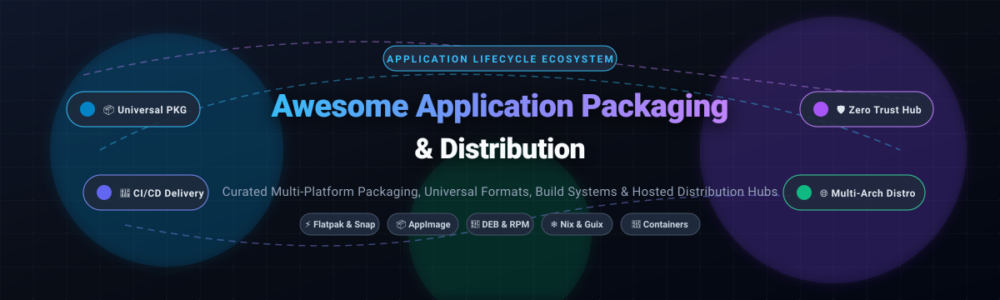

  

# 📦 Awesome Application Packaging & Distribution

  
  
  
  
  
  

> 🚀 **The definitive curated index of SaaS platforms and Open-Source software for Application Packaging, Cross-Platform Desktop Bundling, Binary Distribution, Linux Formats (Flatpak, Snap, AppImage, DEB, RPM), and Cloud Build Pipelines.**

---

## 📑 Table of Contents

- [🌐 Sector Overview & Market Dynamics](#-sector-overview--market-dynamics)
- [☁️ SaaS & Hosted Platforms](#️-saas--hosted-platforms)
- [💻 Open-Source GitHub Projects](#-open-source-github-projects)
- [🛠️ Frameworks for Custom Build Pipelines](#️-frameworks-for-custom-build-pipelines)
- [📈 Star History](#-star-history)
- [💖 Support & Sponsorship](#-support--sponsorship)
- [🤝 How to Contribute](#-how-to-contribute)
- [⚖️ Disclaimer](#️-disclaimer)

---

## 🌐 Sector Overview & Market Dynamics

The global application packaging, deployment, and distribution software market is valued at approximately **$8.1 Billion** (projected to reach **$18.8B–$23.1B** at ~11.2% CAGR), with broader enterprise software delivery networks commanding over **$130+ Billion**. 

The sector experiences **moderate-to-high fragmentation** across platforms, runtime isolation formats (Flatpak, Snap, AppImage, OCI containers), and ecosystem build infrastructure, but exhibits pronounced **winner-take-all / concentrated network effects** within specific sub-domains—most notably Docker Hub dominating cloud container distribution, Flathub emerging as the Linux desktop standard, and Tauri / Electron dominating cross-platform desktop binary packaging.

---

## ☁️ SaaS & Hosted Platforms

| Platform | Company / Backer | Company Scale (Revenue / Valuation) | Pricing (Starting Paid Tier) | Free Tier Limits | Description |
| :--- | :--- | :--- | :--- | :--- | :--- |
| **[Open Build Service (OBS)](https://build.opensuse.org/)** | SUSE / openSUSE Project | **~$800M Revenue** (~$4B–$6B Valuation) | Free community instance; Enterprise SUSE Linux Enterprise Server / Rancher contract extensions start at custom enterprise tiers | 100% Free Forever; default home project worker builds subject to worker hardware constraints (~50 GB disk / standard memory pools per worker job) | Open-source multi-distro build service compiling RPM, DEB, and Arch binaries across architectures. |
| **[Docker Hub](https://hub.docker.com/)** | Docker, Inc. | **~$200M ARR** (~$2.1B Valuation) | Pro Tier starts at **$9/user/month** (annual) or $11/user/month (monthly); Team Tier starts at $15/user/month | Docker Personal (Free Forever): 1 private repository, unlimited public repositories, 200 image pulls / 6 hours (authenticated) or 100 pulls / 6 hours (anonymous), 1 Docker Scout repo; Docker Desktop free only for entities with <250 employees and <$10M ARR | Container image registry and automated build service for cloud and server workloads. |
| **[Snap Store](https://snapcraft.io/)** | Canonical Ltd. | **$291M Revenue** (~$15.5M Operating Profit) | Public publishing is **Free**; dedicated enterprise Brand Stores and private proxy appliances start via commercial enterprise agreements | Free Forever: Unlimited public snap package hosting and distribution; free multi-arch remote builds on Launchpad infrastructure; Snap Store Proxy free tier limited to 25 evaluation devices | Canonical's centralized store and delivery network for SquashFS-confined Snap packages. |
| **[Launchpad](https://launchpad.net/)** | Canonical Ltd. | **$291M Revenue** (~$15.5M Operating Profit) | **Free** for open-source / public projects; private commercial PPA hosting and enterprise build features included via Ubuntu Pro / Canonical enterprise subscriptions | Free Forever: 8 GiB disk space quota per Personal Package Archive (PPA) for source package builds across supported Ubuntu releases and architectures | Ubuntu's source package build farm and PPA repository service. |
| **[Flathub](https://flathub.org/)** | Flathub LLC / GNOME Foundation | **~$1M–$1.2M Annual Budget** (Non-profit foundation & grants) | Free for publishing; developer monetization retains standard payment processing fees (Stripe fees + small platform maintenance contribution) | Free Forever: Unlimited public application listings and OSTree hosting; builds subject to Flatpak quality criteria, sandboxing rules, and review guidelines | Community app store and centralized OSTree repository for sandboxed Flatpak applications. |

---

## 💻 Open-Source GitHub Projects

Curated list of leading open-source application packaging tools, container runtimes, binary bundlers, and package managers, **sorted descending by GitHub Stars_Count**. Beside each project name, the social Stars_Badge links directly to the project's stargazers page.

- **[Tauri](https://github.com/tauri-apps/tauri)**  — Build smaller, faster, and more secure desktop and mobile applications with a web frontend. Bundles native installers (.msi, .exe, .dmg, .deb, .appimage).
- **[Docker Moby](https://github.com/moby/moby)**  — The open-source framework and container engine (Apache-2.0) that defined modern application packaging for cloud, server, and CI/CD pipelines.
- **[Podman](https://github.com/containers/podman)**  — Daemonless, rootless container engine for developing, managing, and running OCI containers and multi-arch pods across systems.
- **[Nix](https://github.com/NixOS/nix)**  — The purely functional package manager (LGPL-2.1) ensuring reproducible builds, atomic upgrades, multiple version coexistence, and instant rollback.
- **[GoReleaser](https://github.com/goreleaser/goreleaser)**  — Deliver Go binaries as fast and easily as possible. Automates cross-compilation, artifact generation, changelogs, Homebrew taps, and multi-distro packaging.
- **[Packer](https://github.com/mitchellh/packer)**  — Build automated machine images, cloud AMIs, and containers for multiple platforms from a single source configuration.
- **[electron-builder](https://github.com/electron-userland/electron-builder)**  — A complete solution to package and build ready-for-distribution Electron apps for macOS, Windows, and Linux with auto-update support out of the box.
- **[distrobox](https://github.com/89luca89/distrobox)**  — Use any Linux distribution inside your terminal with tight host integration. The most accessible tool to test and validate packages across distros without VMs.
- **[FPM (Effing Package Management)](https://github.com/jordansissel/fpm)**  — The packaging Swiss Army knife (MIT). Converts directories, gems, npm, and tarballs into `.deb`, `.rpm`, `.apk`, and OSX packages in seconds.
- **[Skopeo](https://github.com/containers/skopeo)**  — Command line utility that performs various operations on container images and image registries without requiring root or a running daemon.
- **[AppImageKit](https://github.com/AppImage/AppImageKit)**  — The "one app = one file" portable Linux package format. Self-contained ELF executable combining an application tree with a lightweight runtime.
- **[Flatpak](https://github.com/flatpak/flatpak)**  — The sandboxed, runtime-based Linux desktop distribution system (LGPL-2.1). Distributes content via OSTree repositories with deduplication, runtimes, and delta updates.
- **[Toolbx](https://github.com/containers/toolbox)**  — Containerized command-line environments on Linux for software development and debugging (Apache-2.0).
- **[Cloud Native Buildpacks (pack)](https://github.com/buildpacks/pack)**  — CLI for building production-ready OCI container images from source code without writing Dockerfiles.
- **[nfpm](https://github.com/goreleaser/nfpm)**  — nfpm is not fpm. A simple, flexible, modern packaging tool written in Go to build `.deb`, `.rpm`, `.apk`, and `archlinux` packages from a single YAML spec.
- **[ORAS](https://github.com/oras-project/oras)**  — OCI Registry As Storage: distribute arbitrary files, artifacts, configuration bundles, and SBOMs using standard OCI container registries.
- **[Snapd](https://github.com/snapcore/snapd)**  — The daemon and tooling powering `.snap` packages. Mounts read-only SquashFS images with strict AppArmor/seccomp confinement and automated channel rollouts.
- **[Open Build Service (OBS)](https://github.com/openSUSE/open-build-service)**  — The open-source automated build distribution engine powering build.opensuse.org. Compiles DEB, RPM, and Arch packages simultaneously across multiple hardware architectures.
- **[RPM](https://github.com/rpm-software-management/rpm)**  — The core RPM Package Manager powering Fedora, RHEL, openSUSE, and CentOS distributions.
- **[GNU Guix](https://github.com/guix-mirror/guix)**  — Functional GNU package management system and distribution featuring Scheme-based reproducible environments and transactional updates.
- **[alien](https://github.com/linuxmafia/alien)**  — Veteran format conversion utility between RPM, Debian `.deb`, Stampede `.slp`, and Slackware `.tgz` packages.
- **[checkinstall](https://github.com/giuliojiang/checkinstall)**  — Monitor `make install` file writes and generate clean `.deb`, `.rpm`, or Slackware packages directly from source builds.

---

## 🛠️ Frameworks for Custom Build Pipelines

To build a resilient enterprise packaging and delivery pipeline:
1. **Desktop Cross-Platform**: Use **Tauri** or **electron-builder** to package native installers across Windows, macOS, and Linux.
2. **Multi-Distro Packaging**: Combine **nfpm** or **FPM** to emit native `.deb`, `.rpm`, and `.apk` packages directly from CI workflows.
3. **Sandboxed Distribution**: Deploy to **Flathub** via Flatpak manifests or publish to the **Snap Store** for auto-updating channels.
4. **Cloud & Artifact Delivery**: Package multi-arch container images using **Podman** / **Docker** and store software artifacts in OCI registries with **ORAS**.
5. **Cross-Distro Build Farms**: Utilize self-hosted **Open Build Service** or **Launchpad** PPAs for automated architecture compiles.

---

## 📈 Star History

---

## 💖 Support & Sponsorship

Thank you for visiting and supporting this ecosystem initiative! If you find this curated collection helpful for your software engineering, DevOps pipelines, or open-source distribution journey:

- ⭐ **Star this repository** to show your appreciation and boost visibility!
- 🍴 **Fork and contribute** to add new tools, update documentation, or fix outdated information.
- 📢 **Share with fellow developers, sysadmins, and DevOps engineers**.
- ☕ **Buy me a coffee / Become a sponsor**: Support continued curation and open-source maintenance via the [GitHub Sponsors Dashboard](https://github.com/sponsors/ishandutta2007).

---

## 🤝 How to Contribute

1. Fork the repository.
2. Add or update tool entries in `README.md` adhering to the tabular/badge format.
3. Include: Tool Name, Link, 1–2 sentence description, and license/tier classification.
4. Submit a Pull Request with a clear summary of your additions.

---

## ⚖️ Disclaimer

- This is a **community-curated** list — not exhaustive and not an official commercial endorsement.
- Packaging and distribution tools must comply with upstream distribution policies, licensing requirements, and trademark rules for each target ecosystem.
- Self-hosted distribution solutions require proper security hardening, signing key management, and ongoing maintenance. Package signing is critical trust infrastructure.

---

  <b>Built with ❤️ for application developers, DevOps engineers, and release maintainers worldwide.</b>

